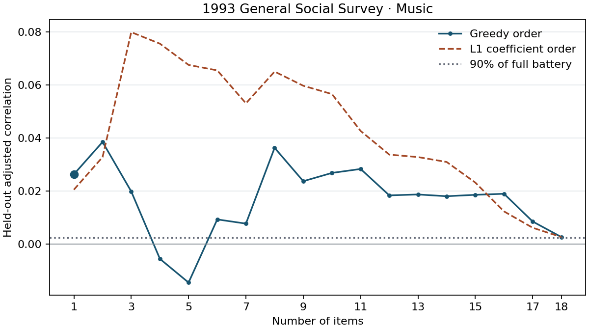

# Part 1 · General liking and happiness

## Findings

**1993 GSS.** The GSS showed no clear association between average music liking and happiness. Among 1,441 adults with analyzable responses, a one-standard-deviation increase in average music liking corresponded to a 0.5 percentage-point higher modeled probability of saying “very happy.” The adjusted cumulative odds ratio was 1.03 [0.92, 1.14] (95% CI), with permutation p = 0.6550. On held-out respondents, adding liking moved AUC from 0.611 to 0.610 (-0.001).

**Shortest quiz.** The full-battery held-out correlation was 0.003 (95% bootstrap interval -0.073 to 0.078). The first crossing was **1 item** (Classical music, r = 0.026). The threshold crossing is exploratory because the full-battery association was weak.

**Matched check.** Within comparable income, marital, health and work groups, the pooled difference in “very happy” was +0.6 percentage points (33.1% in the top liking tercile and 32.5% in the bottom). The comparison covered 524 people in 68 overlapping strata.

**Replication pending.** The original Slovak questionnaire dictionary and response CSV are required to estimate replication. This report contains the GSS results while those files are pending.

## Methods and results

The analysis followed the [plan committed before inspecting outcomes](../PLAN.md). Higher ratings mean more liking and higher ordered outcome values mean greater happiness. The liking score averages observed ratings. The main model adjusts for the retained background variables using ordinal logistic regression. AUC and quiz associations use the preassigned held-out half.

The GSS music battery and missing codes come from the NORC documentation and single-year file. [NORC documentation](https://gss.norc.org/get-documentation.html) · [NORC Stata files](https://gss.norc.org/get-the-data/stata.html)

### GSS control missingness

| Control | Design missing | Total missing | Primary model |
| --- | ---: | ---: | --- |
| AGE | 0 (0.0%) | 5 (0.3%) | retained |
| SEX | 0 (0.0%) | 0 (0.0%) | retained |
| RACE | 0 (0.0%) | 0 (0.0%) | retained |
| EDUC | 0 (0.0%) | 4 (0.2%) | retained |
| REALINC | 0 (0.0%) | 139 (8.7%) | retained |
| MARITAL | 0 (0.0%) | 1 (0.1%) | retained |
| HEALTH | 531 (33.1%) | 535 (33.3%) | excluded |
| WRKSTAT | 0 (0.0%) | 0 (0.0%) | retained |
| CHILDS | 0 (0.0%) | 5 (0.3%) | retained |

### 1993 General Social Survey · Music

Of 1,606 survey records, 1,576 met the battery coverage requirement, 1,573 of those had an outcome, and 1,441 entered the complete-case analysis (720 train, 721 test).

| Estimate | Value |
| --- | ---: |
| Primary log-odds slope per SD (95% CI) | +0.025 [-0.083, +0.134] |
| Cumulative odds ratio per SD (95% CI) | 1.03 [0.92, 1.14] |
| Average modeled change in highest-outcome probability per SD | +0.51 pp |
| Two-sided permutation p | 0.6550 |
| Test AUC, controls only | 0.611 |
| Test AUC, controls and liking | 0.610 |
| Paired test AUC difference | -0.001 |
| With liking residualized on age and education, slope (95% CI) | +0.024 [-0.080, +0.129] |
| Unadjusted r, raw liking / age- and education-residualized liking | +0.028 / +0.002 |
| With response-style terms, slope (95% CI) | +0.006 [-0.109, +0.121] |

Mean score components across complete cases were 3.14 average liking, 5.44 disliked items, 2.22 strongly liked items, 1.10 within-person SD, and 16.97 valid items.

The full-battery held-out correlation was 0.003 (95% bootstrap interval -0.073 to 0.078). The first crossing was **1 item** (Classical music, r = 0.026). The threshold crossing is exploratory because the full-battery association was weak.
Quiz gaps filled using training item means were 5.5% in training and 5.9% in testing.

### GSS matched and weighting checks

Among 973 health-complete matching cases, 68 of 187 occupied strata contained both extremes. They covered 524 of 652 extreme-tercile respondents (80.4%). The shared-stratum rates for bottom and top were 32.5% and 33.1%.

The three-tercile display used 55 strata and 720 respondents. Pooled “very happy” rates for bottom, middle, and top were 35.0%, 31.0%, 32.4%.

In the same 973 health-complete cases, the liking slope was +0.025 [-0.108, +0.157] without health and +0.030 [-0.105, +0.164] with health (95% CIs).

As a weighting sensitivity, the WTSSPS-weighted binary model for “very happy” gave an odds ratio of 1.05 per SD (1,441 cases).

## Limitations

- These are cross-sectional self-reports. Shared response tendencies, familiarity with the items, omitted circumstances, and the direction of influence remain open.
- The main ordinal result and its interval are respondent-level and unweighted. The intervals do not account for GSS sampling clusters. The permutation result assumes exchangeable covariate-adjusted liking residuals.
- GSS music taste varies by education and age. Residualizing on the same age and education terms already in the regression changes the scale of its coefficient while preserving the fitted probabilities. The unadjusted correlations show what changes before the remaining controls enter. [Bryson (1997)](https://doi.org/10.1016/S0304-422X(97)00008-9)
- Exact matching describes the subset with overlapping liking groups. The shortest observed quiz scans several lengths on the test half, so the chosen length needs independent validation.
- The surveys differ in age range, recruitment, wording, culture, and item content. Their effect sizes describe their respective analyzed samples.

## Reproduction

From the repository root, regenerate this report and the figures with `.venv\Scripts\python.exe -m part1`.

| Raw input | SHA-256 |
| --- | --- |
| `1993_stata.zip` | `98c828bbdb20b02ae0efc067a2f24cf1afaf87aaa012d3c97008901359b04e68` |
