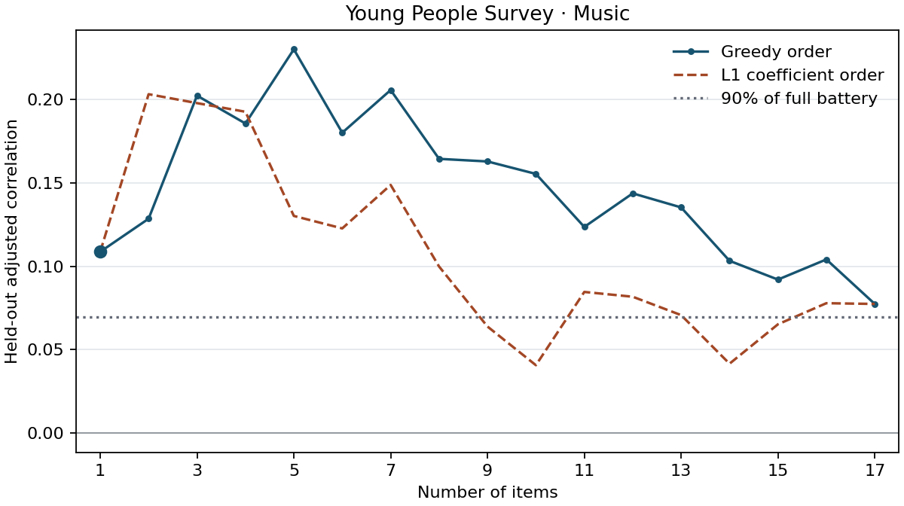
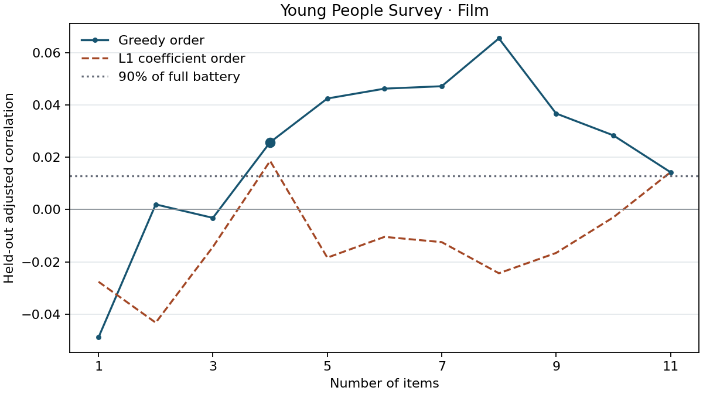
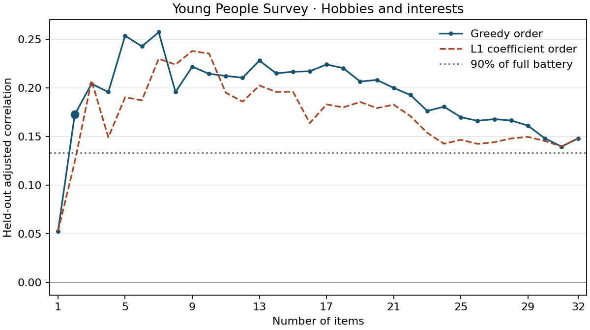
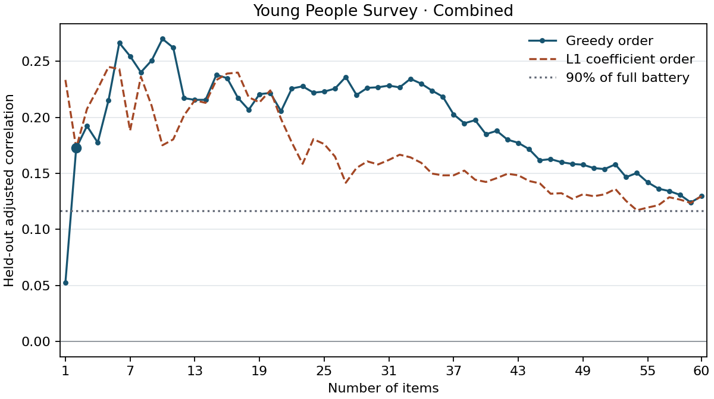

# Part 1 · General liking and happiness

## Findings

**1993 GSS.** The GSS showed no clear association between average music liking and happiness. Among 1,441 adults with analyzable responses, a one-standard-deviation increase in average music liking corresponded to a 0.5 percentage-point higher modeled probability of saying “very happy.” The adjusted cumulative odds ratio was 1.03 [0.92, 1.14] (95% CI), with permutation p = 0.6550. On held-out respondents, adding liking moved AUC from 0.611 to 0.610 (-0.001).

**Shortest quiz.** The full-battery held-out correlation was 0.003 (95% bootstrap interval -0.073 to 0.078). The first crossing was **1 item** (Classical music, r = 0.026). The threshold crossing is exploratory because the full-battery association was weak.

**Matched check.** Within comparable income, marital, health and work groups, the pooled difference in “very happy” was +0.6 percentage points (33.1% in the top liking tercile and 32.5% in the bottom). The comparison covered 524 people in 68 overlapping strata.

**Slovak replication.** In 987 Young People Survey responses, the combined score had an adjusted cumulative odds ratio of 1.26 [1.11, 1.42] per SD (95% CI), with permutation p = 0.0002. A one-SD difference in liking corresponded to a +2.8 percentage-point change in the modeled probability of the highest happiness rating. The descriptive domain odds ratios were 1.32 for hobbies and interests, 1.15 for music, and 0.98 for film. The Slovak survey supports the hypothesized positive direction and the GSS estimate is inconclusive.

**Slovak combined quiz.** The full-battery held-out correlation was 0.130 (95% bootstrap interval 0.041 to 0.217). The first crossing was **2 items** (Physics, Fun with friends, r = 0.173).

## Methods and results

The analysis followed the [plan committed before inspecting outcomes](../PLAN.md). Higher ratings mean more liking and higher ordered outcome values mean greater happiness. The liking score averages observed ratings. The main model adjusts for the retained background variables using ordinal logistic regression. AUC and quiz associations use the preassigned held-out half. AUC differences use the unrounded paired estimates.

The GSS music battery and missing codes come from the NORC documentation and single-year file. [NORC documentation](https://gss.norc.org/get-documentation.html) · [NORC Stata files](https://gss.norc.org/get-the-data/stata.html)

### GSS control missingness

| Control | Design missing | Total missing | Primary model |
| --- | ---: | ---: | --- |
| AGE | 0 (0.0%) | 5 (0.3%) | retained |
| SEX | 0 (0.0%) | 0 (0.0%) | retained |
| RACE | 0 (0.0%) | 0 (0.0%) | retained |
| EDUC | 0 (0.0%) | 4 (0.2%) | retained |
| REALINC | 0 (0.0%) | 139 (8.7%) | retained |
| MARITAL | 0 (0.0%) | 1 (0.1%) | retained |
| HEALTH | 531 (33.1%) | 535 (33.3%) | excluded |
| WRKSTAT | 0 (0.0%) | 0 (0.0%) | retained |
| CHILDS | 0 (0.0%) | 5 (0.3%) | retained |

### 1993 General Social Survey · Music

Of 1,606 survey records, 1,576 met the battery coverage requirement, 1,573 of those had an outcome, and 1,441 entered the complete-case analysis (720 train, 721 test).

| Estimate | Value |
| --- | ---: |
| Primary log-odds slope per SD (95% CI) | +0.025 [-0.083, +0.134] |
| Cumulative odds ratio per SD (95% CI) | 1.03 [0.92, 1.14] |
| Average modeled change in highest-outcome probability per SD | +0.51 pp |
| Two-sided permutation p | 0.6550 |
| Test AUC, controls only | 0.611 |
| Test AUC, controls and liking | 0.610 |
| Paired test AUC difference | -0.001 |
| With liking residualized on age and education, slope (95% CI) | +0.024 [-0.080, +0.129] |
| Unadjusted r, raw liking / age- and education-residualized liking | +0.028 / +0.002 |
| With response-style terms, slope (95% CI) | +0.006 [-0.109, +0.121] |

Mean score components across complete cases were 3.14 average liking, 5.44 disliked items, 2.22 maximum ratings, 1.10 within-person SD, and 16.97 valid items.

The full-battery held-out correlation was 0.003 (95% bootstrap interval -0.073 to 0.078). The first crossing was **1 item** (Classical music, r = 0.026). The threshold crossing is exploratory because the full-battery association was weak.
The L1 order first crossed at k = 1 (Big band, r = 0.021).
Quiz gaps filled using training item means were 5.5% in training and 5.9% in testing.

### Young People Survey · Music

Of 1,010 survey records, 1,010 met the battery coverage requirement, 1,006 of those had an outcome, and 987 entered the complete-case analysis (490 train, 497 test).

| Estimate | Value |
| --- | ---: |
| Primary log-odds slope per SD (95% CI) | +0.142 [+0.020, +0.264] |
| Cumulative odds ratio per SD (95% CI) | 1.15 [1.02, 1.30] |
| Average modeled change in highest-outcome probability per SD | +1.72 pp |
| Two-sided permutation p | 0.0280 |
| Test AUC, controls only | 0.573 |
| Test AUC, controls and liking | 0.566 |
| Paired test AUC difference | -0.007 |
| With liking residualized on age and education, slope (95% CI) | +0.141 [+0.020, +0.262] |
| Unadjusted r, raw liking / age- and education-residualized liking | +0.085 / +0.078 |
| With response-style terms, slope (95% CI) | +0.169 [+0.034, +0.303] |

Mean score components across complete cases were 2.76 average liking, 7.65 low ratings (1–2), 2.17 maximum ratings, 1.19 within-person SD, and 16.91 valid items.

The full-battery held-out correlation was 0.077 (95% bootstrap interval -0.026 to 0.174). The first crossing was **1 item** (Reggae, Ska, r = 0.109). The threshold crossing is exploratory because the full-battery association was weak.
The L1 order first crossed at k = 1 (Reggae, Ska, r = 0.109).
Quiz gaps filled using training item means were 0.5% in training and 0.5% in testing.

### Young People Survey · Film

Of 1,010 survey records, 1,010 met the battery coverage requirement, 1,006 of those had an outcome, and 987 entered the complete-case analysis (490 train, 497 test).

| Estimate | Value |
| --- | ---: |
| Primary log-odds slope per SD (95% CI) | -0.022 [-0.146, +0.102] |
| Cumulative odds ratio per SD (95% CI) | 0.98 [0.86, 1.11] |
| Average modeled change in highest-outcome probability per SD | -0.27 pp |
| Two-sided permutation p | 0.7253 |
| Test AUC, controls only | 0.573 |
| Test AUC, controls and liking | 0.578 |
| Paired test AUC difference | +0.004 |
| With liking residualized on age and education, slope (95% CI) | -0.022 [-0.146, +0.102] |
| Unadjusted r, raw liking / age- and education-residualized liking | -0.003 / -0.001 |
| With response-style terms, slope (95% CI) | +0.018 [-0.153, +0.189] |

Mean score components across complete cases were 3.39 average liking, 3.01 low ratings (1–2), 3.03 maximum ratings, 1.20 within-person SD, and 10.97 valid items.

The full-battery held-out correlation was 0.014 (95% bootstrap interval -0.068 to 0.098). The first crossing was **4 items** (Animated, Western, Fantasy/Fairy tales, Romantic, r = 0.026). The threshold crossing is exploratory because the full-battery association was weak.
The L1 order first crossed at k = 4 (Thriller, Horror, Comedy, Romantic, r = 0.019).
Quiz gaps filled using training item means were 0.2% in training and 0.3% in testing.

### Young People Survey · Hobbies and interests

Of 1,010 survey records, 1,010 met the battery coverage requirement, 1,006 of those had an outcome, and 987 entered the complete-case analysis (490 train, 497 test).

| Estimate | Value |
| --- | ---: |
| Primary log-odds slope per SD (95% CI) | +0.280 [+0.157, +0.402] |
| Cumulative odds ratio per SD (95% CI) | 1.32 [1.17, 1.50] |
| Average modeled change in highest-outcome probability per SD | +3.35 pp |
| Two-sided permutation p | 0.0001 |
| Test AUC, controls only | 0.573 |
| Test AUC, controls and liking | 0.604 |
| Paired test AUC difference | +0.030 |
| With liking residualized on age and education, slope (95% CI) | +0.277 [+0.156, +0.398] |
| Unadjusted r, raw liking / age- and education-residualized liking | +0.149 / +0.139 |
| With response-style terms, slope (95% CI) | +0.288 [+0.161, +0.414] |

Mean score components across complete cases were 2.88 average liking, 13.83 low ratings (1–2), 6.35 maximum ratings, 1.37 within-person SD, and 31.85 valid items.

The full-battery held-out correlation was 0.148 (95% bootstrap interval 0.065 to 0.229). The first crossing was **2 items** (Physics, Fun with friends, r = 0.173).
The L1 order first crossed at k = 3 (Physics, Celebrities, Fun with friends, r = 0.207).
Quiz gaps filled using training item means were 0.5% in training and 0.4% in testing.

### Young People Survey · Combined

Of 1,010 survey records, 1,010 met the battery coverage requirement, 1,006 of those had an outcome, and 987 entered the complete-case analysis (490 train, 497 test).

| Estimate | Value |
| --- | ---: |
| Primary log-odds slope per SD (95% CI) | +0.230 [+0.108, +0.353] |
| Cumulative odds ratio per SD (95% CI) | 1.26 [1.11, 1.42] |
| Average modeled change in highest-outcome probability per SD | +2.77 pp |
| Two-sided permutation p | 0.0002 |
| Test AUC, controls only | 0.573 |
| Test AUC, controls and liking | 0.584 |
| Paired test AUC difference | +0.010 |
| With liking residualized on age and education, slope (95% CI) | +0.228 [+0.107, +0.350] |
| Unadjusted r, raw liking / age- and education-residualized liking | +0.127 / +0.119 |
| With response-style terms, slope (95% CI) | +0.244 [+0.119, +0.369] |

Mean score components across complete cases were 2.94 average liking, 24.49 low ratings (1–2), 11.55 maximum ratings, 1.35 within-person SD, and 59.73 valid items.

The full-battery held-out correlation was 0.130 (95% bootstrap interval 0.041 to 0.217). The first crossing was **2 items** (Physics, Fun with friends, r = 0.173).
The L1 order first crossed at k = 1 (Fun with friends, r = 0.233).
Quiz gaps filled using training item means were 0.5% in training and 0.4% in testing.

### GSS matched and weighting checks

Among 973 health-complete matching cases, 68 of 187 occupied strata contained both extremes. They covered 524 of 652 extreme-tercile respondents (80.4%). The shared-stratum rates for bottom and top were 32.5% and 33.1%.

The three-tercile display used 55 strata and 720 respondents. Pooled “very happy” rates for bottom, middle, and top were 35.0%, 31.0%, 32.4%.

In the same 973 health-complete cases, the liking slope was +0.025 [-0.108, +0.157] without health and +0.030 [-0.105, +0.164] with health (95% CIs).

As a weighting sensitivity, the WTSSPS-weighted binary model for “very happy” gave an odds ratio of 1.05 per SD (1,441 cases).

### Slovak questionnaire coverage

The original questionnaire dictionary defined the item domains. The combined battery uses all items listed below. [Young People Survey](https://www.kaggle.com/datasets/miroslavsabo/young-people-survey)

The happiness outcome prompt was “I am 100% happy with my life.” Respondents rated their agreement on a 1–5 scale. Genre ratings ranged from low to high enjoyment. Hobby and interest ratings ranged from low to high interest. Village/town refers to where the respondent spent most of childhood.

| Background field | Missing responses |
| --- | ---: |
| Age | 7 (0.7%) |
| Gender | 6 (0.6%) |
| Education | 1 (0.1%) |
| Village - town | 4 (0.4%) |
| Number of siblings | 6 (0.6%) |

#### Music

| Item | Original prompt |
| --- | --- |
| Dance | Dance, Disco, Funk |
| Folk | Folk music |
| Country | Country |
| Classical music | Classical |
| Musical | Musicals |
| Pop | Pop |
| Rock | Rock |
| Metal or Hardrock | Metal, Hard rock |
| Punk | Punk |
| Hiphop, Rap | Hip hop, Rap |
| Reggae, Ska | Reggae, Ska |
| Swing, Jazz | Swing, Jazz |
| Rock n roll | Rock n Roll |
| Alternative | Alternative music |
| Latino | Latin |
| Techno, Trance | Techno, Trance |
| Opera | Opera |

#### Film

| Item | Original prompt |
| --- | --- |
| Horror | Horror movies |
| Thriller | Thriller movies |
| Comedy | Comedies |
| Romantic | Romantic movies |
| Sci-fi | Sci-fi movies |
| War | War movies |
| Fantasy/Fairy tales | Tales |
| Animated | Cartoons |
| Documentary | Documentaries |
| Western | Western movies |
| Action | Action movies |

#### Hobbies and interests

| Item | Original prompt |
| --- | --- |
| History | History |
| Psychology | Psychology |
| Politics | Politics |
| Mathematics | Mathematics |
| Physics | Physics |
| Internet | Internet |
| PC | PC Software, Hardware |
| Economy Management | Economy, Management |
| Biology | Biology |
| Chemistry | Chemistry |
| Reading | Poetry reading |
| Geography | Geography |
| Foreign languages | Foreign languages |
| Medicine | Medicine |
| Law | Law |
| Cars | Cars |
| Art exhibitions | Art |
| Religion | Religion |
| Countryside, outdoors | Outdoor activities |
| Dancing | Dancing |
| Musical instruments | Playing musical instruments |
| Writing | Poetry writing |
| Passive sport | Sport and leisure activities |
| Active sport | Sport at competitive level |
| Gardening | Gardening |
| Celebrities | Celebrity lifestyle |
| Shopping | Shopping |
| Science and technology | Science and technology |
| Theatre | Theatre |
| Fun with friends | Socializing |
| Adrenaline sports | Adrenaline sports |
| Pets | Pets |

## Limitations

- These are cross-sectional self-reports. Shared response tendencies, familiarity with the items, omitted circumstances, and the direction of influence remain open.
- The main ordinal result and its interval are respondent-level and unweighted. The intervals do not account for GSS sampling clusters. The permutation result assumes exchangeable covariate-adjusted liking residuals.
- GSS music taste varies by education and age. Residualizing on the same age and education terms already in the regression changes the scale of its coefficient while preserving the fitted probabilities. The unadjusted correlations show what changes before the remaining controls enter. [Bryson (1997)](https://doi.org/10.1016/S0304-422X(97)00008-9)
- Exact matching describes the subset with overlapping liking groups. The shortest observed quiz scans several lengths on the test half, so the chosen length needs independent validation.
- The surveys differ in age range, recruitment, wording, culture, and item content. Their effect sizes describe their respective analyzed samples.

## Reproduction

From the repository root, regenerate this report and the figures with `.venv\Scripts\python.exe -m part1`.

| Raw input | SHA-256 |
| --- | --- |
| `1993_stata.zip` | `98c828bbdb20b02ae0efc067a2f24cf1afaf87aaa012d3c97008901359b04e68` |
| `columns.csv` | `4422e3f7bb33e020211c6d0599e39d9d85b4d852b6f66a2a64dba7bf20704e4c` |
| `responses.csv` | `e6b2297a06292c439f58d33ea11e35d154dbe4ebdad0e2bff032ddf07d14af01` |
